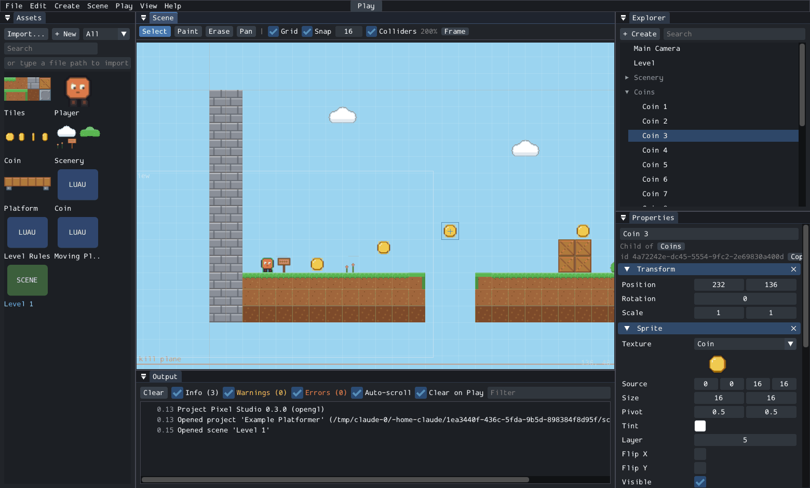

# Project Pixel

> **Project Pixel** is a working title. In code, files and executables the
> project uses the neutral prefix `px`; the user-facing name is a single CMake
> variable (`PX_PRODUCT_NAME`). See [ADR 0001](docs/adr/0001-language-build-and-naming.md).

A 2D user-generated game platform: an engine, a creator studio and an online
platform where anyone can make, publish and play 2D games. The long-term
vision is in [PROJECT_VISION.md](PROJECT_VISION.md).



## Current status (version 0.9.0)

Milestones 0 (engineering foundation), 1 (engine prototype), 2 (Luau
scripting), 3 (Studio foundation), 4 (multiplayer prototype), 5 (visual
scripting and expanded engine: prefabs, animation clips, tilesets), 6
(the platform's core loop: accounts, publishing, catalog, game servers,
saved player data, moderation) and 7 (cross-platform clients: browsers
playing with desktop players, HTTPS, gamepads, touch controls, player
settings, Android and iOS apps built in CI), 8 (launcher and social: a
launcher in the desktop, phone and browser apps, game pictures, profiles,
friends with presence, joining and inviting friends, blocking, shared
leaderboards) and 9 (internet readiness: encrypted game traffic, sandboxed
game servers with CPU and memory limits, email confirmation and password
resets, account deletion, backups, health and metrics, a container image
and a deployment guide) are complete. See [ROADMAP.md](ROADMAP.md) for
detail.

| Area | Status |
|---|---|
| CMake/C++20 build, pinned dependencies, warnings-as-errors | Implemented, verified on Linux (GCC 13, Clang 18) |
| Window, main loop, keyboard input (SDL3) | Implemented, verified on Linux (X11 + OpenGL) and Windows (Direct3D, under Wine); windowless smoke test passes in CI on Linux, Windows and macOS |
| Gamepads and touch screens: every game playable with a pad (buttons stand for the usual keys) and with on-screen controls made from its actions; a menu with VSync, frame limit, scaling, FPS and touch settings | Implemented; touch controls and the menu used on Linux (mouse as a finger), layouts unit tested. **No real gamepad or touch screen tried yet** ([guide](docs/input-devices.md)) |
| 2D rendering: sprites, tilemaps, layers, camera, pixel-perfect scaling, debug text | Implemented, verified by screenshots |
| Entity/component scene model with stable ids, parent/child hierarchy | Implemented, unit tested |
| Studio (desktop editor): projects, Explorer, Scene view, Properties, Assets, Output, script editor, undo, play/stop | Implemented; a game was built in it from an empty project and runs in `px-player`. Used on Linux (X11) and on a Windows 11 PC (Direct3D 11); builds and passes its smoke test in CI on Windows and macOS. **Not yet used on a real Mac** ([guide](docs/studio.md)) |
| Game types: platformer and top-down, chosen when a project is created | Implemented; each has a controller, default input, an example and Toolbox items |
| Toolbox: a starter library of art, behaviours and ready-made objects (28) usable in any project | Implemented; every object is inserted, saved and played in tests; a top-down game was built from an empty project with it in Studio |
| Kinematic collision: solid tiles/boxes, one-way platforms, slopes, triggers | Implemented, unit tested |
| Prefabs: saved entity trees, copies in scenes that keep their own changes when the prefab is updated, `World.spawn` from scripts | Implemented; unit tested, used in Studio on Linux, spawned entities replicate in multiplayer tests ([guide](docs/prefabs.md)) |
| Animation clips (assets) and an `Animator` that follows the character's movement; animation editor in Studio | Implemented; unit tested, used in Studio on Linux ([guide](docs/animation.md)) |
| Tilesets with per-tile collision (solid, none, one-way, slopes) and tags; tile rectangle and bucket fill; tileset editor | Implemented; unit tested, used in Studio on Linux ([guide](docs/tilesets.md)) |
| Visual scripting: node graphs compiled to Luau, graph editor in Studio | Implemented; every node type compiles in tests, used in Studio on Linux ([guide](docs/visual-scripting.md)) |
| Platformer movement (coyote time, jump buffer, variable jump), top-down movement (8 directions) | Implemented, unit tested |
| Versioned project/scene file format with validation | Implemented, unit tested |
| Headless simulation (no graphics) | Implemented; used by the dedicated server and automated tests |
| Multiplayer: dedicated server (`px-server`), joining with `px-player --connect` or hosting with `--host`, UDP transport (ENet), delta snapshots, interpolation, prediction of the own character | Prototype; server and player windows played on one Linux computer over real UDP; three-player level completed through a simulated lossy network in CI on Linux, Windows and macOS. **Not yet played across a real network** ([guide](docs/multiplayer.md)) |
| Studio *Test Multiplayer*: a local server and 1-4 player windows | Implemented, used on Linux |
| Platform (`px-platform`): accounts, publishing from Studio with versions and upload checks, catalog, game servers started on demand with signed join tickets, saved player data (`Data.get/set`), reports and moderation | The whole loop (publish, browse, join, play, save) runs in tests with real game server processes in CI on Linux, Windows and macOS, and was used from Studio and the player on Linux. HTTPS (Mbed TLS) with certificate checks in every client ([guide](docs/platform.md)) |
| Ready for the internet: encrypted game traffic (UDP and WebSockets), game servers and upload checks sandboxed (seccomp, Landlock) with CPU and memory limits, email confirmation, password resets, deleting accounts and downloading their data, online backups and restore, `/healthz` and Prometheus `/metrics`, certificates renewed without a restart, a container image, Compose file and systemd unit | Implemented; CI builds the image and plays a level through it (HTTPS, a bot over the published UDP port, backup restored into a new volume, a renewed certificate), checks a packet capture for plaintext, and drives the account pages with mail through a real SMTP server with STARTTLS. **Not yet run on a public server with a real domain** ([deployment](docs/deployment.md), [accounts](docs/accounts.md)) |
| Playing in a browser: the platform's `/play` page, the WebAssembly player joining the same game servers as desktop players over WebSockets (`wss://` with HTTPS) | Verified in CI: headless Chromium plays the top-down route on a platform game server while a desktop bot is there over UDP, over HTTP and HTTPS. **Not yet played by a person in a browser** ([details](docs/platform.md#browsers)) |
| Luau scripting: sandbox, CPU/memory limits, lifecycle, gameplay API, several behaviours per entity | Implemented; verified on Linux, Windows (MSVC CI, MinGW + Wine), macOS (CI), WebAssembly (CI) |
| Example games, loaded from project files | A platformer and a top-down game, both playable; coins, keys, hazards, win conditions and moving platforms are Luau scripts; automated runs complete both levels |
| Hot reload of scripts and scenes (F5 in px-player) | Implemented, verified manually with simulated key presses |
| Windows | Builds and passes all tests in CI (Visual Studio 2022) and on a Windows 11 PC (Build Tools 2026), where the example level was played to the end in Studio; MinGW-w64 build runs under Wine 9 |
| macOS | Builds and passes all tests in CI (Apple Clang, arm64). **Not yet played in a real window** |
| Memory safety | Unit tests, headless playthrough, player and Studio smoke tests run clean under AddressSanitizer + UBSan with leak detection |
| Browser (WebAssembly) | Engine and tests pass under Node.js in CI; the browser build (WebGL 2) completes the scripted level and plays platform games in headless Chromium in CI. Not yet played by a person ([details](docs/platform-support.md#browser)) |
| Android and iOS apps (px-player with the launcher and a bundled game, touch controls) | Built in CI: an APK (arm64-v8a, x86_64), started on an emulated Android phone, and an iOS app, run on a simulated iPhone (UIKit, Metal); both open the launcher and play the bundled game from it. **Not tested on real phones** ([details](docs/platform-support.md#mobile)) |
| Launcher: log in, browse games with pictures, a game's page with leaderboards, friends, profile, play and join friends; in px-player (Dear ImGui) and on the browser page | Implemented; tested against a real platform in CI (every page, playing, joining a friend, inviting from a game, saved login; the browser page at computer and phone sizes with the real WebAssembly player); used with mouse and keyboard on Linux ([guide](docs/launcher.md)) |
| Friends and profiles: portraits, about text, requests, presence (online, playing what), joining friends, invitations, blocking (never on one server), reports about accounts | Implemented in the platform; tested with real game servers ([guide](docs/social.md)) |
| Leaderboards: declared in `project.json`, submitted by server scripts (`Leaderboard.submit`), each player's best kept by the platform for everyone | Implemented; scores travel from game servers to the platform and back in tests; the examples' best times appear in the launcher ([guide](docs/leaderboards.md)) |
| Audio, text/fonts in games; chat; marketplace | Planned (Milestone 10 and later) |

## Building

### Prerequisites

- CMake 3.25+ and a C++20 compiler: GCC 13+, Clang 16+, or Visual Studio /
  Build Tools 2022 (17.8+) or 2026 (Apple Clang from Xcode 15.3+, macOS 13.3+)
- Ninja on Linux and macOS (Windows uses Visual Studio's own build system)
- Internet access on the first configure (SDL3 and nlohmann/json are
  downloaded and verified by SHA-256; see [docs/dependencies.md](docs/dependencies.md))
- Python 3 with Pillow, only to regenerate the example art and the starter
  library (`tools/`)

**Linux** also needs SDL3's system development headers. On Ubuntu/Debian:

```sh
sudo apt install build-essential cmake ninja-build pkg-config \
  libx11-dev libxext-dev libxcursor-dev libxi-dev libxrandr-dev libxfixes-dev \
  libxss-dev libxtst-dev libxkbcommon-dev libwayland-dev wayland-protocols \
  libegl1-mesa-dev libgl1-mesa-dev libgles2-mesa-dev libdrm-dev libgbm-dev \
  libasound2-dev libpulse-dev libdbus-1-dev libudev-dev
```

### Build and test on Windows

1. Install **Build Tools for Visual Studio** (2022 or 2026) from
   https://visualstudio.microsoft.com/visual-cpp-build-tools/ and tick the
   **"Desktop development with C++"** workload. (A full Visual Studio with
   that workload works too.)
2. Install **CMake** from https://cmake.org/download/ (Windows x64 Installer)
   and choose *"Add CMake to the system PATH"*. Restart any open terminals and
   editors afterwards, including VS Code and GitHub Desktop if you start VS
   Code from it; check with `cmake --version`.
3. In PowerShell, in the repository folder:

```powershell
cmake --preset windows                    # configure into build\windows (newest Visual Studio found)
cmake --build --preset windows-debug      # first build also compiles SDL3 (a few minutes)
ctest --preset windows-debug              # 8 tests, about 30 seconds
.\build\windows\apps\studio\Debug\px-studio.exe
```

The other programs are in `build\windows\apps\player\Debug\` and
`build\windows\apps\headless\Debug\`. In VS Code, the **CMake Tools**
extension offers the same presets (pick *Windows: newest installed Visual
Studio...*).

### Build and test on Linux and macOS

```sh
cmake --preset dev            # configure (Debug, Ninja) into build/dev
cmake --build --preset dev    # first build also compiles SDL3 (~1-3 minutes)
ctest --preset dev            # unit tests, headless playthroughs, player smoke test
```

`ctest` also runs Studio once with SDL's dummy video driver
(`studio_smoke_headless_display`, about 15 seconds).

Other presets: `release`, `asan` (AddressSanitizer + UBSan), `headless` (no
SDL or graphics at all), and `vs2022` on Windows to force Visual Studio 2022.

Windows executables can also be cross-compiled from Linux with MinGW-w64:

```sh
sudo apt install g++-mingw-w64-x86-64-posix
cmake -S . -B build/mingw -G Ninja -DCMAKE_BUILD_TYPE=Release \
      -DCMAKE_TOOLCHAIN_FILE=cmake/toolchains/mingw-w64-x86_64.cmake
cmake --build build/mingw
```

The resulting `px-player.exe`, `px-server.exe` and `px-studio.exe` need no extra DLLs. Copy
`examples/` and `library/` next to them: `px-player.exe` then starts the
example with no arguments, and Studio uses the examples for new projects and
the library for its Toolbox.

### Make a game in Studio

```sh
./build/dev/apps/studio/px-studio                      # welcome screen: new or open project
./build/dev/apps/studio/px-studio path/to/project      # open a project directly
```

Create a project: give it a name (Studio remembers the folder you used last),
choose the kind of game (platformer or top-down) and start from that kind's
example level or an empty scene. Click or drag ready-made things from the
**Toolbox** (heroes, ground, coins, keys, enemies, exits and more), paint
tiles, attach Luau behaviours, press F5 to play and Ctrl+S to save. The
[Studio guide](docs/studio.md) has a five-minute Toolbox tutorial, a
tutorial with your own art and script, and every panel, shortcut and
limitation.

### Run

```sh
./build/dev/apps/player/px-player                      # the launcher: a platform's games, or the examples on this computer
./build/dev/apps/player/px-player examples/platformer  # plays the platformer example
./build/dev/apps/player/px-player examples/topdown     # the top-down example
./build/dev/apps/player/px-player path/to/project      # any project folder
./build/dev/apps/headless/px-headless examples/platformer --ticks 600
```

Controls: arrows or A/D to move, Space/Z/W/Up to jump (top-down: arrows or
WASD to walk), R restart, F5 reload
scripts and scenes from disk, F1 debug overlay (colliders, FPS, player
position, script memory), F2 screenshot, Esc the menu (settings, quit).
Gamepads work as soon as they are connected; `--touch` shows the touch
controls with the mouse as a finger ([input devices](docs/input-devices.md)).

Useful options: `--frames N --screenshot out.png` runs a fixed number of
deterministic frames and saves the last one; `--input-script FILE` plays
recorded input (see [docs/input-scripts.md](docs/input-scripts.md)). Run with
`--help` for the full list.

### Play together

```sh
./build/dev/apps/server/px-server examples/topdown                     # a server (Ctrl+C stops it)
./build/dev/apps/player/px-player examples/topdown --connect localhost # join it (once per player)
./build/dev/apps/player/px-player examples/platformer --host            # or: play and host in one window
```

Players on other computers use `--connect <address of the server>`; the
server listens on UDP port 7777. In Studio, *Play > Test Multiplayer*
starts a server and player windows for you. The
[multiplayer guide](docs/multiplayer.md) explains how games behave online,
the scripting API for players, and how it works inside.

### Publish and play on a platform

```sh
./build/dev/services/platform/px-platform     # a platform on this computer (http://127.0.0.1:8730)
```

In Studio: *Platform > Publish, Play and Log In...*, create an account,
publish the open project, then *Play* it from the Play tab (it runs on a
game server the platform starts). Players use the launcher: start
`px-player` without a game, log in, and see the games with their pictures,
leaderboards and your friends ([launcher guide](docs/launcher.md)). Or from
the command line:

```sh
./build/dev/apps/headless/px-headless examples/platformer --platform http://127.0.0.1:8730 \
    --user Ada --password 'choose-one' --register --publish --title "Coin Run"
./build/dev/apps/player/px-player --platform http://127.0.0.1:8730 --play 1 --user Ada --password 'choose-one'
```

To play in a browser too, build the WebAssembly player (`cmake --preset
wasm`, see [platform-support.md](docs/platform-support.md#browser)) and start
the platform with `--web-player build/wasm/apps/player`, then open
http://127.0.0.1:8730/play. HTTPS: `--https-port` with a certificate
(`--dev-certificate` makes one for testing). The [platform guide](docs/platform.md)
covers browsers, HTTPS, saved player data, moderation, the HTTP API and what
is not secure yet. Android and iOS builds: [platform-support.md](docs/platform-support.md#mobile).

### Try scripting

The example's coins, moving platform and win condition are Luau scripts in
`examples/platformer/scripts/`. With `px-player` running:

1. Open `examples/platformer/scripts/coin.luau` and change
   `Game.addScore(self.value)` to `Game.addScore(self.value * 10)`, or change
   `period = 4` in `moving_platform.luau` to `period = 2`.
2. Press **F5**. The project reloads from disk; no recompiling.
3. Introduce a mistake (e.g. misspell `self.value`) and press F5 again: the
   error, with file and line, appears on screen while the game keeps running.

Headless checks: `px-headless examples/platformer --input-script
examples/platformer/tests/full_run.input --log-events --expect-level-complete`.
Guide: [docs/scripting.md](docs/scripting.md); every API function:
[docs/scripting-api.md](docs/scripting-api.md).

## Repository layout

```
engine/            engine modules (static libraries), one folder per module
  core/            logging, errors, math, ids, sandboxed file access, timing, key names
  crypto/          secure random numbers, hashing, password hashing, signatures
  assets/          asset ids, asset registry, image decoding
  scene/           entities, components, scenes
  physics/         kinematic AABB collision, one-way platforms, slopes
  project/         project, scene, prefab, animation and tileset file formats
  scripting/       Luau sandbox, resource limits, gameplay API, Script lifecycle, visual scripts
  runtime/         headless fixed-tick game simulation and gameplay systems
  render/          renderer interface, camera, scene-to-draw-call extraction
  platform_sdl/    SDL3 window, input and renderer backend
  net/             multiplayer: transports (UDP, loopback), protocol, snapshots, game server and client
  online/          the platform from the engine's side: package checks, HTTP client
  editor/          editor model without UI: projects, scene documents, undo, play mode
apps/player/       px-player, the desktop client
apps/headless/     px-headless, graphics-free runner, multiplayer bots and network tests
apps/server/       px-server, the dedicated multiplayer server
apps/studio/       px-studio, the desktop editor (Dear ImGui)
services/platform/ px-platform, the platform service (accounts, publishing, game servers)
examples/          example game projects (content only, no code): platformer, topdown
library/           starter library behind Studio's Toolbox (generated by tools/)
tests/             automated tests
tools/             developer tools (example and library generators, dependency updates)
docs/              detailed documentation and architecture decision records
third_party/       vendored libraries (stb_image, doctest, Luau subset, Dear ImGui, ENet)
```

## Documentation

- [ARCHITECTURE.md](ARCHITECTURE.md): modules, boundaries and data flow
- [ROADMAP.md](ROADMAP.md): milestones, progress, next steps
- [CONTRIBUTING.md](CONTRIBUTING.md): coding standards and workflow
- [docs/studio.md](docs/studio.md): Studio guide and tutorial
- [docs/multiplayer.md](docs/multiplayer.md): playing together, multiplayer scripting, how the networking works
- [docs/platform.md](docs/platform.md): the platform: running it, publishing, playing, game servers, saved data, moderation, API
- [docs/deployment.md](docs/deployment.md): running a platform on the internet: the container image, Compose, systemd, certificates, backups, monitoring
- [docs/accounts.md](docs/accounts.md): email addresses, password resets and changes, deleting an account, downloading its data; email for operators
- [docs/launcher.md](docs/launcher.md): the launcher in px-player and on the browser page; game pictures
- [docs/social.md](docs/social.md): profiles, friends, presence, joining and inviting, blocking, reports
- [docs/leaderboards.md](docs/leaderboards.md): declaring leaderboards, the script API, where scores are kept
- [docs/project-format.md](docs/project-format.md): `project.json` and scene files
- [docs/library-format.md](docs/library-format.md): the starter library behind the Toolbox
- [docs/components.md](docs/components.md): generated reference of every component and field
- [docs/engine.md](docs/engine.md): coordinates, scene model, simulation loop, rendering
- [docs/platform-support.md](docs/platform-support.md): desktop, mobile and browser: what is verified, how to build, what is planned
- [docs/input-devices.md](docs/input-devices.md): keyboard, gamepads, touch controls and the player's settings
- [docs/scripting.md](docs/scripting.md): Luau scripting guide: lifecycle, sandbox, limits, realms, versioning
- [docs/scripting-api.md](docs/scripting-api.md): generated API reference
- [docs/visual-scripting.md](docs/visual-scripting.md): visual scripts (node graphs) and the graph editor
- [docs/prefabs.md](docs/prefabs.md), [docs/animation.md](docs/animation.md), [docs/tilesets.md](docs/tilesets.md): prefabs, animation clips, tilesets
- [docs/security.md](docs/security.md): threat model and current protections
- [docs/adr/](docs/adr/): architecture decision records
