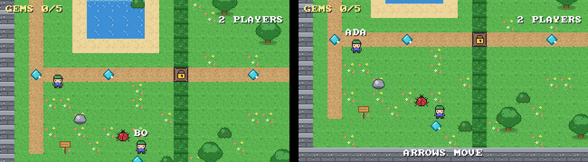

# Multiplayer guide

Several people can play the same game together: one **server** runs the
game, and every player's **client** (a `px-player` window) sends what they
press and shows what the server sends back. Games need no network code:
the Player entities, controllers and scripts that work alone work online.



Status: **prototype (Milestone 4)**. Verified on Linux with real UDP
between separate processes and windows, and in CI on Linux, Windows and
macOS (the end-to-end tests run there); not yet played across the internet
by people. See [Limitations](#limitations).

## Try it

**In Studio:** open a project, then *Play > Test Multiplayer > Server + 2
Players*. Studio saves the project, starts a server and two game windows
on this computer, and shows everything they print in *Output*. Click a
window to play in it. *Stop Multiplayer* in the toolbar closes them all.
The project's start scene is what is played.

**From a terminal** (in the build's `apps/` folders, or next to each other
in a package):

```sh
px-server examples/topdown                        # the server (Ctrl+C stops it)
px-player examples/topdown --connect localhost    # a player on the same computer
px-player examples/topdown --connect 192.168.1.20 --name Ada   # from another computer on the network
```

Or without a separate server: one player hosts, others join.

```sh
px-player examples/platformer --host --name Ada            # plays and serves on port 7777
px-player examples/platformer --connect 192.168.1.20:7777  # another computer joins
```

Everyone needs the same version of the game's project folder and of the
engine; a different copy is refused with a message saying so. The server
uses UDP port **7777** (`--port` changes it). The first time a server
starts, Windows asks whether it may use the network: allow *private
networks* to play with other computers at home (games on one computer work
either way). Joining over the internet needs that port forwarded
to the server; matchmaking and hosted servers come with the platform
(Milestone 6).

| `px-server` option | Meaning |
|---|---|
| `--port N` | UDP port (default 7777) |
| `--max-players N` | players at once, 1-64 (default 8) |
| `--name TEXT` | server name shown to players |
| `--snapshot-rate HZ` | world updates per second (default 30) |
| `--restart-delay S` | seconds after the level is complete before it starts again (default 8; -1: never) |

| `px-player` option | Meaning |
|---|---|
| `--connect ADDRESS[:PORT]` | join a server |
| `--host [--port N]` | run a server in this window and play on it |
| `--name NAME` | the name others see above your character (default: your login name; at most 24 characters) |

In a game, the top right shows how many are playing and names float above
the other players; F1 adds ping, bandwidth and prediction statistics. If
the connection ends, the window says why.

## Making games for several players

**Players and spawn points.** In a multiplayer game the scene's entity with
a `Player` component is a template: everyone who joins gets their own copy
of it (with its children and scripts), placed where the template stands.
Put several Player entities in a scene to have several spawn points;
players take turns over them. Players who share a spawn point are placed
side by side. Each character is moved by its own player's keys. Alone, the
same scene plays exactly as before.

**Scripts run on the server.** Every behaviour runs once, on the server,
for everybody; there is no client-side scripting yet. Things that already
work for any player:

- triggers report every player: a coin collected by anyone disappears for
  everyone, `other:hasComponent("Player")` is true for every character;
- `entity:respawn()`, `entity.spawnPoint` work per character, so
  checkpoints are personal;
- `Game.addScore`, `Game.setObjective`, `Game.completeLevel` are shared by
  all players (co-operative play).

New for multiplayer ([API reference](scripting-api.md)):

| Member | Use |
|---|---|
| `function Behaviour:PlayerJoined(player)` | a player joined; `player` is their character (alone: called once at the start) |
| `function Behaviour:PlayerLeft(player)` | a player left; the character is removed right after |
| `Players.getAll()`, `Players.count()` | the characters in the game |
| `entity.playerName`, `entity.playerId` | who controls a character |
| `Input.isDown(action, player)`, `Input.wasPressed(action, player)` | one player's input; without `player`: any player's |

```lua
-- Greets players and counts them on the HUD.
local Lobby = {}

function Lobby:PlayerJoined(player)
    Game.setObjective(player.playerName .. " JOINED - " .. Players.count() .. " PLAYING")
end

function Lobby:PlayerLeft(player)
    Game.setObjective(player.playerName .. " LEFT")
end

return Lobby
```

```lua
-- A chest that the player standing at it opens with "use" (add a "use"
-- action in File > Project Settings). Needs a trigger BoxCollider.
local Chest = {
    properties = { points = 10 },
}

function Chest:TriggerEnter(other)
    if other:hasComponent("Player") then
        self.visitor = other
    end
end

function Chest:TriggerExit(other)
    if other == self.visitor then
        self.visitor = nil
    end
end

function Chest:Tick()
    if self.visitor and Input.wasPressed("use", self.visitor) then
        Game.addScore(self.points)
        self.entity:destroy()
    end
end

return Chest
```

**When the level is complete** the server shows the message to everyone,
counts down and starts the level again with the same players
(`--restart-delay`).

## How it works

```
 client (px-player)                                  server (px-server)
 ------------------                                  ------------------
 keys -> input frame every tick ---- Input ------->  input buffer per player
 (last 16 unconfirmed frames each time, unreliable)        |
                                                     GameSession.tick() (scripts, physics)
 snapshot history <---------------- Snapshot ------  capture world, encode the change
   |                (30/s, unreliable, a change      from what this client confirmed
   |                 from a state it confirmed)
   +-> others: drawn ~100 ms in the past, blended between two snapshots
   +-> own character: predicted from unconfirmed inputs with the server's movement code
```

**Joining.** The client sends *Hello* (engine version, protocol version,
a hash of the game, the player's name). The server checks all of them,
creates the player's character and answers *Welcome* (player id, tick
rate, snapshot rate), or *Reject* with the reason.

**Input.** Every client tick (60 per second by default) the client sends
its newest input frames: which actions are held and which were pressed. It
repeats the frames the server has not used yet, so a lost message costs
nothing. The server keeps a small buffer per player (two frames) so uneven
arrival does not cause stalls, and uses one frame per tick. If a player's
input runs late anyway, the server keeps their held keys for that tick and
lets that player's buffer grow by a frame (up to eight, about 130 ms); after
five calm seconds it shrinks again. If a backlog builds up, frames are
merged (presses are kept) to catch up.

**Snapshots.** After a tick the server captures the replicated components
of every entity (`net/Replication.cpp`: which components and fields replicate
is one table on top of the [component descriptors](components.md)). Each
client gets the difference between that state and the newest state it has
confirmed, field by field: unchanged entities cost nothing, a moving
character a few dozen bytes. If a client has confirmed nothing yet (or the
level restarted), the difference is from the initial scene, which the
client loads from its own copy of the project. Entities created later
(the players' characters) are sent in full once.

**Interpolation.** A client draws other entities two snapshot intervals
plus two ticks in the past (about 100 ms), blending positions between the
snapshots around that moment, so movement is smooth even when snapshots
arrive unevenly. A jump of more than 64 units is drawn as a teleport.

**Prediction.** The own character must react at once, so the client runs
the same controller and collision code as the server (`runtime/Movement.hpp`)
on the inputs the server has not confirmed. Each new snapshot says which of
its inputs the server has used; the client restarts from the server's state
of the character, replays the rest, and fades any difference out over
0.1 s. Things the client does not simulate (moving platforms carrying the
character, springs and other scripts) are corrected that way after a round
trip.

**Bandwidth** in the examples: about 3 kB/s from the server to each player
and under 2 kB/s back.

### Protocol

Messages start with a type byte; numbers are little-endian, most are
variable-length (`net/Bytes.hpp`). Protocol version 1 (`net/Protocol.hpp`):

| Message | Direction | Delivery | Content |
|---|---|---|---|
| Hello | client -> server | reliable | magic, protocol version, engine version, game hash, name |
| Input | client -> server | unreliable | newest snapshot received, newest input sequence number, up to 32 frames |
| Goodbye | client -> server | reliable | (leaving) |
| Welcome | server -> client | reliable | player id, tick rate, snapshot interval, server name |
| Reject | server -> client | reliable | reason code and text, then the connection is closed |
| Snapshot | server -> client | unreliable | level epoch, tick, baseline tick, newest input used, world change |

The game hash covers the engine and protocol versions, the replication
format, the project id, tick rate, input actions and the initial scene
(without its Player templates). Changing the protocol means raising
`kProtocolVersion`; changing which components or fields replicate changes
the hash by itself.

The transport (`net/Transport.hpp`) is an interface with reliable and
unreliable messages. Desktop builds use UDP through ENet
([ADR 0018](adr/0018-multiplayer-networking.md)); browser builds have no UDP,
so they cannot join yet.

## Testing

| Test | What it does |
|---|---|
| `unit_tests` (`test_multiplayer.cpp`) | players joining and leaving a session, per-player input, the scripting API, and the example scripts on this page |
| `unit_tests` (`test_net.cpp`) | encoding, every kind of world change, fuzzed decoders, the loopback network |
| `unit_tests` (`test_netgame.cpp`) | server and clients over a simulated network: moving and seeing each other, prediction without corrections, the top-down level completed through a lossy link, leaving, full server, a different game copy, restarts, garbage and silent connections |
| `net_simulated_playthrough` | three clients, 60 ms latency, 15 ms jitter, 5 % loss; client 1 plays the top-down route; the server must see the level completed |
| `net_udp_localhost` | the same machinery over real UDP sockets |
| `server_starts_and_stops` | `px-server` runs and exits cleanly |

Two tools help with networking work:

```sh
# A server and N clients in one process, over a simulated network; client 1 plays a route.
px-headless examples/topdown --net-test --clients 3 --latency 80 --jitter 20 --loss 5 \
    --input-script examples/topdown/tests/full_run.input --expect-level-complete
# A scripted bot that joins a real server.
px-headless examples/topdown --connect localhost --name Bot --input-script route.input
```

`--net-test` prints, per client, the snapshots used and dropped, prediction
corrections, bandwidth and how far the predicted character ended from the
server's (`--udp` uses real sockets instead of the simulation).

## Limitations

- **No security for connections yet:** anyone who can reach the port can
  join, names are not verified and traffic is not encrypted. Run servers
  only among people you trust ([security.md](security.md)).
- Score and objective are shared; there is no per-player state in the API
  yet (per-player score, inventory).
- No client-side scripts, no messages from client scripts to server
  scripts (like Roblox RemoteEvents) yet: clients only send input.
- Every client receives every entity; very large levels will need interest
  management.
- Players do not collide with each other.
- The browser build cannot join games (no UDP in browsers).
- Studio's test uses the start scene of the saved project, not unsaved
  changes; a server already using port 7777 makes the test fail (its error
  is shown in Output).
