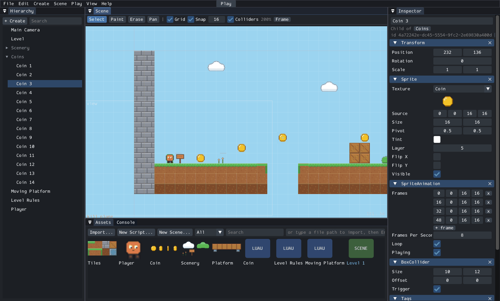

# Studio guide

Studio (`px-studio`) is the desktop editor. You create a project, build
scenes by placing and configuring entities, write Luau behaviours, and play
the game inside the editor. Everything Studio saves is the normal project
format ([project-format.md](project-format.md)), so `px-player` and
`px-headless` run it unchanged.



Status: **foundation (Milestone 3)**. Verified on Linux (X11, OpenGL and
software renderer). Builds in CI on Windows (MSVC) and macOS; not yet used
on a real Windows or macOS desktop. See [Limitations](#limitations).

## Starting Studio

```sh
./build/dev/apps/studio/px-studio                    # welcome screen
./build/dev/apps/studio/px-studio path/to/project    # open a project directly
```

| Option | Effect |
|---|---|
| `--reset-layout` | Forget the saved panel layout |
| `--verbose` | Debug messages in the console |
| `--smoke-test` | Scripted run used by the automated tests (see [Testing Studio](#testing-studio)) |
| `--screenshot FILE` | With `--smoke-test`: save the final frame as a PNG |

The welcome screen creates a new project (empty, or a copy of the
platformer template with its art and scripts), opens a project folder, or
reopens a recent one. A new project must go into a new or empty folder.

Settings (recent projects, grid, snapping, UI scale) and the panel layout
are stored per user: `~/.local/share/px/studio/` on Linux,
`%APPDATA%\px\studio\` on Windows, `~/Library/Application Support/px/studio/`
on macOS.

## The window

| Panel | What it does |
|---|---|
| **Hierarchy** | The entities of the open scene as a tree. Drag an entity onto another to make it a child (hold Shift to place it before that entity instead); drop it on the empty area below to move it to the top level. Right-click for create, rename (F2), duplicate, copy, paste as child, delete. The search box filters by name. Entities with problems are shown in red. |
| **Scene** | The viewport. Select, move, paint tiles; shows colliders, camera bounds and the grid. While playing it shows the running game. |
| **Inspector** | The selected entity's name, components and scripts. Every field of every component can be edited; hover a field's name for its description. Numbers are kept within their allowed range. |
| **Assets** | Images, scripts and scenes of the project. Import files, create scripts and scenes, rename, find uses, delete. Drag an asset onto a field, an entity or the Scene view. |
| **Console** | Log messages, script output and errors. Double-click an error with a file and line to open the script there. Repeated messages are folded. |
| **Script** | A plain text editor for `.luau` files, with save and compile errors. |
| **Project Settings** | Name, start scene, virtual resolution, background colour, input actions and keys (File > Project Settings). |

Panels can be dragged, docked and tabbed. View > Reset Layout restores the
default arrangement; View > UI Scale changes the size of everything.

## Tutorial: a game from an empty project

About ten minutes; every step is done in Studio, no files are edited by
hand. (This exact sequence was carried out to verify Milestone 3; the
resulting project then ran unchanged in `px-player` and `px-headless`.)

1. **New project.** On the welcome screen enter a name, a folder and choose
   *Empty*. You get a scene with a camera.
2. **Import art.** In *Assets*, click *Import...* (or type a file path into the
   field next to it and press Enter, or drop files onto the window). For a
   quick start, import `tiles.png`, `player.png` and `coin.png` from
   `examples/platformer/assets`.
3. **Ground.** *+ Create > Tilemap*. It appears centred in the view with the
   imported tileset. Choose the Paint tool (B), pick a tile in the
   Inspector's palette and drag along the bottom of the map; paint a short
   platform higher up. *Solid* is on, so the tiles block movement.
4. **Player.** *+ Create > Player*. It comes with a sprite, collider and
   platformer controller, and the camera starts following it.
5. **A coin.** Drag `coin.png` from Assets into the Scene view. The coin image
   is a strip of four frames: in the Inspector set *Source* to `0 0 16 16` and
   *Size* to `16 16`. *Add Component > BoxCollider* and tick *Trigger*.
6. **Its behaviour.** *Add Script*, type `Coin`, *Create*. The script opens;
   replace the template with:

   ```lua
   local Coin = {
       properties = { value = 5 },
   }

   function Coin:TriggerEnter(other)
       if not other:hasComponent("Player") then
           return
       end
       Game.addScore(self.value)
       Game.setObjective("Score: " .. Game.getScore())
       self.entity:destroy()
   end

   return Coin
   ```

   The line under the editor says *Compiles. Properties: value. Handles:
   TriggerEnter*, and the Inspector shows `value` for this coin.
7. **More coins.** Click the coin in the Scene view, press Ctrl+D and drag the
   copy somewhere else. Repeat.
8. **Save** with Ctrl+S, then **Play** with F5. Click the Scene view and use
   the arrow keys and Space. F5 again stops; everything is back as it was.
9. Run it outside Studio: `px-player "path/to/My Game"`.

## Building a level

1. **Create entities** with *+ Create* in the Hierarchy, Entity menu, or by
   dragging an image from Assets into the Scene view (creates a sprite there).
   Presets: Empty, Group, Sprite, Tilemap, Solid Block, Trigger, Player,
   Camera. New entities appear in the centre of the view, on the grid, with a
   fitting image from the project if there is one.
2. **Select** by clicking in the Scene view or the Hierarchy. Ctrl+click
   toggles, Shift+click adds, dragging on empty space selects with a box.
   Clicking the same spot again cycles through overlapping entities.
3. **Move** by dragging a selected entity, or with the arrow keys (1 unit;
   Shift+arrow moves one grid cell). With *Snap* on, drags move in whole grid
   steps; hold Alt to move freely. Escape cancels a drag. Exact values go in
   the Inspector (*Transform*).
4. **Organise** with Group entities: drag entities onto a group in the
   Hierarchy. Children keep their place on screen when they are re-parented
   and move with their parent afterwards.
5. **Paint tiles**: select a Tilemap, pick a tile in its Inspector palette,
   choose the Paint tool (B) and drag in the Scene view. Right-drag or the
   Erase tool (E) erases; Alt+click picks the tile under the mouse. Resize the
   map in the Inspector (tiles are kept at the top left). Turn on *Solid* to
   make painted tiles block movement.
6. **Components**: *Add Component* in the Inspector, grouped by category.
   Adding *PlatformerController* also adds the components it needs.
   A component that another one needs cannot be removed until that one is.

### Viewport controls

| Input | Action |
|---|---|
| Mouse wheel | Zoom around the mouse |
| Middle drag, right drag, Space + left drag, Pan tool (H) | Pan |
| F | Frame the selection (or the whole scene) |
| Q / H / B / E | Select / Pan / Paint / Erase tool |
| Arrows, Shift+arrows | Nudge the selection |

The toolbar above the view has the tools, grid and snapping options, grid
size, collider display and zoom.

## Scripts

- *New Script...* in Assets (or *Add Script > Create* in the Inspector)
  creates a script from a template with `Start`/`Tick`/trigger handlers and a
  `properties` table.
- Attach scripts by dragging them from Assets onto an entity (in the Scene
  view or the Hierarchy) or onto the Inspector's *Add Script* button, or pick
  one from *Add Script*. An entity can have up to 16 behaviours; they run in
  the order listed.
- Each attached script shows the properties it declares, with their types and
  defaults. Values you change are saved with the entity; *Reset* returns a
  property to the script's default.
- Edit scripts in the Script panel (double-click a script asset) or in your
  own editor. Studio recompiles a script when it is saved and notices when a
  file changes on disk. Compile errors show in the Inspector, the Console and
  the Script panel.

Scripting itself is described in [scripting.md](scripting.md) and
[scripting-api.md](scripting-api.md).

## Playing

| Button | Key | Effect |
|---|---|---|
| Play | F5 | Runs the open scene as it is now, unsaved scene and script changes included |
| Pause | F6 | Freezes the game; the Inspector shows its live state |
| Step | F7 | Advances one tick (1/60 s) while paused |
| Stop | F5 | Returns to editing |

The game runs on a **copy** of the scene, with the same simulation as
`px-player`. Changes made while playing (moving things, editing fields in
the Inspector) affect only the running game and are discarded on Stop; the
orange *PLAYING* label in the toolbar and the Scene view shows that you are
playing. Click the Scene
view to give the game keyboard input. *Game camera* switches between what
the player sees and a free editor camera. Script errors appear in the Console
and stop only the failing behaviour, as in `px-player`.

## Saving

- **Ctrl+S** (File > Save All) saves the scene, all changed scripts and the
  project settings. An asterisk in the window title (and in a script's tab)
  marks unsaved changes.
- Studio refuses to save a scene that would not load (for example a sprite
  without an image); such entities are red in the Hierarchy, and the
  Inspector lists the problems.
- Closing the project, opening another scene or quitting with unsaved
  changes asks whether to save.
- Files are written in a canonical form (stable order, two-space JSON), so
  saving an unchanged scene produces no difference in version control.
  `px-headless --resave PROJECT` rewrites a hand-edited project the same way.

## Undo

Ctrl+Z / Ctrl+Y (or Ctrl+Shift+Z). Every operation is one step: a whole drag,
a typed value, a paint stroke, a paste. The Edit menu shows what will be
undone. Undo history is per scene, is kept until the scene is closed, and is
bounded in memory (oldest steps are dropped). Script text has its own undo
in the Script panel. Asset operations (import, rename, delete) and project
settings are not undoable; deleting an asset asks first and lists where it
is used.

## Copy, paste and duplicate

Ctrl+C copies the selected entities, with their children, as text (a
`px.entities` JSON document) to the system clipboard; Ctrl+V pastes them into
the open scene. Pasting into another project works when it has the same
assets (for example two projects made from the same template); otherwise
Studio names the missing asset and pastes nothing. Ctrl+D duplicates in place.
References between copied entities (a camera following a copied player) point
to the copies; references to entities outside the copy are kept when they
exist in the target scene.

## Keyboard shortcuts

| Keys | Action |
|---|---|
| Ctrl+S | Save all |
| Ctrl+O | Open project |
| Ctrl+Z, Ctrl+Y / Ctrl+Shift+Z | Undo, redo |
| Ctrl+C, Ctrl+V, Ctrl+D, Delete | Copy, paste, duplicate, delete (when the Hierarchy or Scene view has focus) |
| Ctrl+A | Select all top-level entities (moving them moves everything) |
| F2 | Rename (Hierarchy) |
| F5, F6, F7 | Play/Stop, Pause, Step |

## Testing Studio

`ctest` runs `studio_smoke_headless_display`: Studio opens the example
project with SDL's dummy video driver and software renderer, then, through
the same code paths as the UI, selects the player, opens a script and the
project settings, creates every entity preset, duplicates, copies and pastes,
switches to the paint tool, undoes everything (the scene must be exactly as
saved), plays for two seconds holding *right* (the player must collect a
coin without script errors) and stops (the scene must be unchanged). It
writes nothing to the project. `--screenshot` saves the final frame.

The editor model (`engine/editor`) has its own unit tests
(`tests/test_editor.cpp`): project creation, assets, saving and reloading,
undo/redo, hierarchy operations, copy/paste, picking and play mode.

## Limitations

These are known and planned, not bugs:

- **No prefabs** yet: copy/paste and duplicate are the way to reuse entities.
- **One entity at a time in the Inspector**; with several selected it shows the
  last one clicked (moving, duplicating and deleting work on all).
- Undo keeps whole-scene snapshots: fine for scenes of thousands of entities,
  but memory-bound for very large ones (the oldest steps are dropped).
- The script editor is plain text: no syntax highlighting or completion.
- Rotation and scale affect sprites, but colliders and tilemaps ignore them
  (as in the runtime).
- No multi-scene editing, no scene transitions from scripts yet.
- Studio has not been used by people other than its developers, and not yet
  on a real Windows or macOS desktop.
- Studio is not available in the browser build.

Design and rationale: [ADR 0013](adr/0013-studio-ui-dear-imgui.md) (UI
toolkit), [ADR 0015](adr/0015-studio-architecture.md) (editor architecture
and undo).
